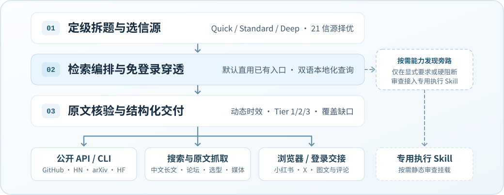

# Best Practice Search

面向 Agent 的跨平台检索编排 Skill。适用于需要多信源交叉验证的工具选型、最佳实践与踩坑调研、一手出处溯源，以及可复用的图片、矢量图与视频素材查找。

它作为**检索编排层**，把任务定级、按信源拆题、免登录穿透策略、动态时效与证据分级、原文核验和结构化交付串成一套低噪音、可复跑的流程。

## 检索流程



1. **定级拆题与选信源**。按复杂度选定 `Quick`（1–2 站快核）、`Standard`（默认 3–4 站选型）或 `Deep`（多平台双语深挖），从 21 个高频信源中挑选互补站点，按中英文社区习惯构造查询词。 [信源目录](skills/best-practice-search/references/sources.md) · [检索路由](skills/best-practice-search/references/source-routing.md)
2. **优先走已有入口与免登录穿透**。优先调用公开 API、CLI（如 `gh`、HN Algolia、arXiv、Hugging Face、Stack Exchange、MediaWiki）、网页搜索或已有浏览器会话。仅在用户显式要求或核心信源受阻且获授权时，才启动**能力发现旁路**去 GitHub / Skill 目录审查并接入专用信源执行 Skill。 [信源访问手册](skills/best-practice-search/references/platform-access-playbook.md)
3. **原文核验与结构化交付**。基于系统日期采用**动态滑动时间窗**与 `Tier 1 / 2 / 3` 离散证据分级，强制标注实际读取层级（`原文已读` / `部分已读` / `仅索引可见` / `访问受限`），按标准模板输出结论、踩坑验收项、来源清单与覆盖缺口。 [输出模板](skills/best-practice-search/references/output-template.md)

## 使用方式

本地使用时，将完整的 [`skills/best-practice-search/`](skills/best-practice-search/) 放进你的 Agent 支持的 Skill 目录，或让 Agent 直接读取 [SKILL.md](skills/best-practice-search/SKILL.md) 及其引用的文件。

内容推送到 GitHub 后，可通过 Skills CLI 从 [tyrogdd/best-practice-search](https://github.com/tyrogdd/best-practice-search) 安装：

```sh
npx skills add tyrogdd/best-practice-search --skill best-practice-search
```

可以用这样一条请求试跑：

> 我需要做一张可编辑的系统论文架构图。请按 Standard 或 Deep 模式查同类论文原图、Agent 绘图实践和工具局限，优先近 12 个月的现行实践，给出可定位原文、踩坑验收项和访问缺口。

## 文件入口

| 内容 | 文件 |
| --- | --- |
| 编排入口、三级预算、动态时效与示范沉淀边界 | [Skill](skills/best-practice-search/SKILL.md) |
| 零依赖公开 API 统一检索脚本（HN / arXiv / HF / Lobste.rs / SE / Wikimedia） | [public_search.py](skills/best-practice-search/scripts/public_search.py) |
| 任务选站映射、双语查询、动态时效/证据分级与能力发现旁路 | [检索路由](skills/best-practice-search/references/source-routing.md) |
| 21 个高频中英文社区、实时动态、项目/学术/模型与合规素材信源 | [信源目录](skills/best-practice-search/references/sources.md) |
| 免登录公开 API/CLI、搜索算子降级与读取层级标准 | [信源访问手册](skills/best-practice-search/references/platform-access-playbook.md) |
| Quick / Standard / Deep 交付契约与发送前自检清单 | [输出模板](skills/best-practice-search/references/output-template.md) |
| 通用 Web/CLI 环境、Codex 环境及自定义工具清单模板 | [通用 Web/CLI](skills/best-practice-search/references/tool-profiles/generic-web-cli.md) · [Codex 清单](skills/best-practice-search/references/tool-profiles/codex.md) · [工具清单模板](skills/best-practice-search/references/tool-profiles/template.md) |
| 与 Skill 本体解耦的科研绘图示范案例 | [科研绘图社区检索](examples/research-figures/community-search.md) · [科研绘图流程案例](examples/research-figures/workflow-playbook.md) |

工具清单只负责把信源路由到当前环境实际可用的入口，实际注册、依赖与授权由各运行环境管理。无浏览器环境可优先依靠公开 API、CLI 与网页检索完成公开原文核验；需登录会话或视觉核对时交接给具备相应入口的一方，不绕过认证或人机验证。

## 许可

本仓库的原创规则、工具清单和示例文字采用 MIT 许可。外部论文、帖子、视频以及链接指向的第三方 Skills 适用各自的许可。 [许可正文](LICENSE)
